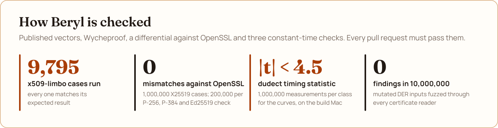
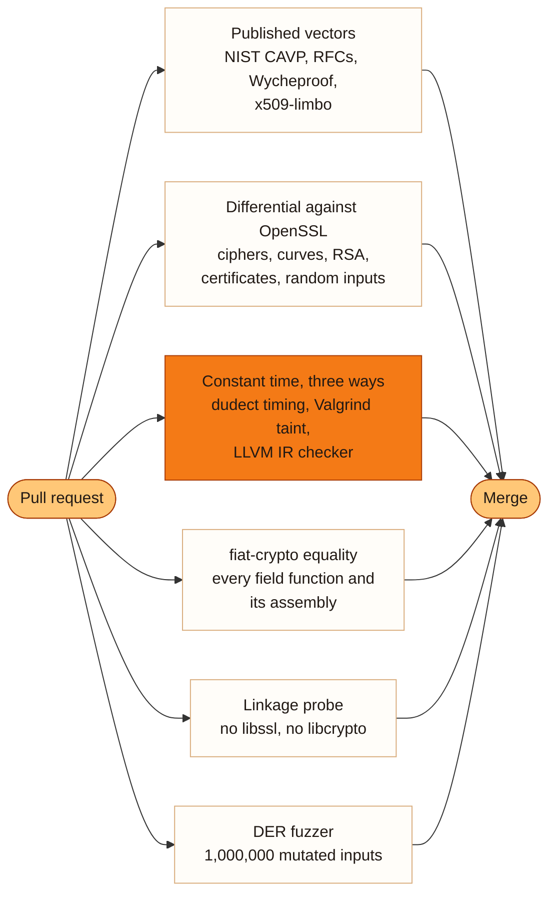

<a href="#install">
<picture>
  <source media="(prefers-color-scheme: dark)" srcset="docs/brand/hero-dark.svg">
  
</picture>
</a>

<p align="center">
  <picture>
    <source media="(prefers-color-scheme: dark)" srcset="docs/brand/badges-dark.svg">
    
  </picture>
</p>

<p align="center">
  <b>Beryl is the Amber framework's cryptography, written in Crystal with no OpenSSL linked.</b><br>
  Hashes, AEADs, Ed25519, X25519, P-256, P-384, RSA and X.509 path validation.
</p>

<br>

## Install

```yaml
dependencies:
  beryl:
    github: amberframework/beryl
    version: 0.2.4
```

```crystal
require "beryl"

Beryl::Crypto.digest("contents of a file")                             # SHA-256
tag = Beryl::Crypto.authenticate("message", key: secret_key)           # HMAC-SHA256
Beryl::Crypto.verify_authentication("message", tag, key: secret_key)   # => true
Beryl::Crypto.derive_key(shared_secret, info: "cookies", bytesize: 32) # HKDF-SHA256
sealed = Beryl::Crypto.encrypt("message", key: key_of_32_bytes)         # XChaCha20-Poly1305
Beryl::Crypto.decrypt(sealed, key: key_of_32_bytes)                    # => Bytes, or nil if changed
signing_key = Beryl::Crypto.generate_signing_key                         # Ed25519
signature = Beryl::Crypto.sign("message", signing_key: signing_key)
Beryl::Crypto.verify_signature("message", signature, verification_key: signing_key.verification_key) # => true

chain = Beryl::Certificates.read_pem_chain(File.read("chain.pem"))
Beryl::Certificates.verify_server_chain(chain, hostname: "example.com") # => the verified path, or raises
```

The calls on `Beryl::Crypto` always use the algorithm Beryl recommends today. `Beryl::Crypto::V1` names each algorithm exactly, and `Beryl::Crypto::Compatibility` holds the old ones that existing formats still need.

> [!NOTE]
> Beryl is opt-in today. It becomes a default in Amber once its own gates pass, and every pull request must pass them to merge. 0.2.0 has the hashes, MACs, AEADs, public-key algorithms and certificate validation below, and TLS 1.3 as a client and a server ([docs/tls.md](docs/tls.md), [CHANGELOG.md](CHANGELOG.md)).

## What's inside

| Area | Algorithms | Standards | Guide |
|---|---|---|---|
| Hashes and MACs | SHA-224, SHA-256, SHA-384, SHA-512, SHA-512/256, HMAC, HKDF; for existing formats MD5, SHA-1 and PBKDF2 | FIPS 180-4, RFC 2104, RFC 5869, RFC 8018 | [hashes-and-macs.md](docs/crypto/hashes-and-macs.md) |
| Authenticated encryption | XChaCha20-Poly1305, ChaCha20-Poly1305, AES-GCM; for existing formats AES-CBC | draft-irtf-cfrg-xchacha-03, RFC 8439, FIPS 197, SP 800-38D, SP 800-38A | [ciphers-and-aeads.md](docs/crypto/ciphers-and-aeads.md) |
| Curves | X25519 key agreement, Ed25519 signatures, P-256 ECDSA (RFC 6979 nonces) and ECDH, P-384 ECDSA verification | RFC 7748, RFC 8032, FIPS 186-5, SP 800-186, SEC 1 | [public-key.md](docs/crypto/public-key.md) |
| RSA | PKCS #1 v1.5 and PSS signatures, OAEP encryption, 2,048 to 4,096-bit private keys | RFC 8017 | [public-key.md](docs/crypto/public-key.md#rsa) |
| Certificates | X.509 certificates, CRLs and private key files; chain verification against the pinned Mozilla roots or the system bundle; host names checked | RFC 5280, RFC 9525, RFC 7468 | [certificates.md](docs/certificates.md) |
| TLS | TLS 1.3 client and server (`Beryl::TLS`), shaped like `OpenSSL::SSL`: session tickets, HelloRetryRequest, ALPN, SNI, KeyUpdate, record size limit; TLS 1.3 only | RFC 8446 (9846), RFC 8448, RFC 8449, RFC 7301, RFC 6066, RFC 8701 | [tls.md](docs/tls.md) |

### Processor instructions, and Data Independent Timing

| Processor | Hashes | AES-GCM and AES-CBC | Curves and RSA |
|---|---|---|---|
| Apple Silicon | ARMv8 SHA1, SHA2 and SHA512 instructions | `aese`/`aesd`, `pmull` and `eor3` | P-256 and P-384 field arithmetic and RSA's Montgomery multiplication in AArch64 assembly |
| Linux on AArch64 | the same, each found at run time | the same, found at run time | the same |
| Linux on x86-64 | SHA-NI for SHA-1, SHA-224 and SHA-256 | AES-NI and `pclmulqdq` | P-256 field multiplication and squaring in x86-64 assembly (`mulq`/`adcq`), fiat-crypto's field arithmetic for the rest, RSA in Crystal |
| Anything else | portable Crystal | portable Crystal | portable Crystal |

On Arm, every operation on a secret (HMAC, HKDF, PBKDF2, the AEADs, AES key setup, every private-key operation) runs with the processor's Data Independent Timing mode on. Without it, Apple M4 ran an X25519 multiplication measurably faster for a scalar with few set bits, though the compiled code has no branch on the scalar; with it on, every timing case is clean ([public-key.md](docs/crypto/public-key.md#how-the-code-avoids-leaking-secrets)). x86-64 gives programs no such mode. AMD Zen 3 and Zen 4 CI runners ran P-256 multiplication by the scalar 1 measurably faster, so the curve multiplications give every window fresh operands: odd digits for the P-256 and P-384 generator, randomized starting points for X25519 and edwards25519, a blinded ECDSA nonce inversion ([public-key.md](docs/crypto/public-key.md#timing-on-x86-64)).

## Speed

<picture>
  <source media="(prefers-color-scheme: dark)" srcset="docs/brand/public-key-speed-dark.svg">
  
</picture>

Hashes, MACs and AEADs, against OpenSSL 4.1.0 on an Apple M1 Max (median of ten or more rounds of 2 s per arm). All 42 hash and HMAC rows and all 32 AEAD rows are at least as fast, with the whole paired 95% interval on that side:

| Algorithm | 64 B | 1 KiB | 16 KiB | 1 MiB |
|---|---|---|---|---|
| SHA-256 | 2.59× as fast | 1.2× as fast | | 1.002× as fast |
| SHA-512 | 2.03× as fast | 1.12× as fast | | 1.014× as fast |
| HMAC-SHA-256 | 1.18× as fast | 1.015× as fast | | 1.001× as fast |
| ChaCha20-Poly1305, seal | 1.23× as fast | 1.044× as fast | 1.13× as fast | 1.15× as fast |
| ChaCha20-Poly1305, open | 1.21× as fast | 1.035× as fast | 1.053× as fast | 1.076× as fast |
| XChaCha20-Poly1305, seal | 2.01× as fast | 1.31× as fast | 1.16× as fast | 1.16× as fast |
| XChaCha20-Poly1305, open | 1.93× as fast | 1.3× as fast | 1.098× as fast | 1.063× as fast |
| AES-128-GCM, seal | 1.49× as fast | 1.078× as fast | 1.063× as fast | 1.048× as fast |
| AES-128-GCM, open | 1.27× as fast | 1.049× as fast | 1.054× as fast | 1.053× as fast |
| AES-256-GCM, seal | 1.45× as fast | 1.078× as fast | 1.087× as fast | 1.08× as fast |
| AES-256-GCM, open | 1.24× as fast | 1.04× as fast | 1.068× as fast | 1.07× as fast |

The hashes were measured at 64 B, 1 KiB and 1 MiB. AES-CBC, which does not authenticate, ranges from 4.92× as fast (AES-128 decryption at 64 B) to 1.073× slower (AES-128 decryption at 1 MiB).

<details>
<summary><b>The public-key and certificate numbers as a table</b></summary>
<br>

Apple M4 with all ten cores reserved, ten rounds of 2 s of processor time per arm, against OpenSSL as the bench prints it (4.0.1). Milestone F3b: curves at commit `e7a0765`, RSA and certificates at commit `05d1481`.

| Operation | Beryl against OpenSSL |
|---|---|
| X25519 key generation | 1.21× as fast |
| X25519 shared secret | 1.034× as fast |
| Ed25519 key generation | 1.23× as fast |
| Ed25519 sign | 1.15× as fast |
| Ed25519 verify | 1.34× as fast |
| P-256 key generation | 1.49× as fast |
| P-256 ECDSA sign | 1.28× as fast |
| P-256 ECDSA verify | 1.3× as fast |
| P-256 ECDH shared secret | 1.056× as fast |
| P-384 ECDSA verify | 1.5× as fast |
| RSA-2048 PKCS #1 v1.5 sign | 1.11× as fast |
| RSA-2048 PKCS #1 v1.5 verify | 1.17× as fast |
| RSA-2048 OAEP decrypt | 1.12× as fast |
| RSA-3072 PKCS #1 v1.5 sign | 1.092× as fast |
| RSA-3072 PKCS #1 v1.5 verify | 1.2× as fast |
| RSA-4096 PKCS #1 v1.5 sign | 1.087× as fast |
| RSA-4096 PKCS #1 v1.5 verify | 1.21× as fast |
| Read 256 certificates, keys left until used | 6.21× as fast |
| Read 256 certificates, public keys decoded | 5.27× as fast |
| Verify a chain with an ECDSA leaf | 1.34× as fast |
| Verify a chain with an RSA leaf | 1.17× as fast |

</details>

Every row, with operations per second and its paired 95% interval, and how to rerun it: [hashes-and-macs.md](docs/crypto/hashes-and-macs.md#speed), [ciphers-and-aeads.md](docs/crypto/ciphers-and-aeads.md#speed), [public-key.md](docs/crypto/public-key.md#speed) and [certificates.md](docs/certificates.md#speed).

## How it's verified

<picture>
  <source media="(prefers-color-scheme: dark)" srcset="docs/brand/verified-dark.svg">
  
</picture>



CI runs these on Linux x86-64 and Linux AArch64 for every pull request ([ci.yml](.github/workflows/ci.yml)); the one exception is the hash differential, below.

- **Published vectors and Wycheproof.** 4,957 cases for the hashes and MACs, 2,957 for the curves, the NIST CAVP and Wycheproof files for the ciphers and RSA, and 5,947 Wycheproof cases whose keys are read from DER. Every vector file is pinned by sha256 and checked again before it is read.
- **x509-limbo.** Of its 9,807 cases, 9,795 run and every one matches its expected result; the 12 skipped are printed with the reason.
- **Differential against OpenSSL.** Random inputs through both libraries, with outputs equal byte for byte and altered inputs refused by both: 1,000,000 cases per cipher and for X25519, 200,000 for Ed25519, P-256 and P-384, and 20,000, 5,000 and 2,000 per RSA scheme at 2,048, 3,072 and 4,096 bits. Certificates: 40,960 Certificate Transparency log chains get the same verdict as OpenSSL. The hashes and MACs (1,000,000 cases each) run on request, because they take one to two hours.
- **dudect timing.** Each secret operation under a fixed secret against random secrets, with the Welch t statistic required below 4.5: 10,000,000 measurements per class for HMAC and the ciphers and 1,000,000 for the curves on the build Mac, 1,000,000 and 100,000 in CI. Each check is decided by two runs out of three, and CI logs the processor it ran on.
- **Valgrind secret taint.** Every key, message and scalar is undefined memory to Memcheck, so any branch or address computed from one is an error. A deliberately leaky comparison must be reported, and CI checks that it is.
- **LLVM IR checker.** `scripts/check_secret_flow.rb` follows secrets through the optimized IR and reports any branch, memory index or division that depends on one. Assembly must use only instructions whose timing does not depend on their operands. Each rule was tested by planting leaks.
- **fiat-crypto.** The curve field arithmetic is translated from fiat-crypto's pinned, machine-checked output; every translated function and every one in assembly equals fiat-crypto's C on 100,000,000 inputs (1,000,000 in CI).
- **No OpenSSL.** CI builds a probe with `-Dwithout_openssl` and fails if `ldd` lists libssl or libcrypto.

> [!TIP]
> These gates, not an outside audit, decide when Beryl becomes a default. Each guide lists its own gates and the command that runs each one.

## Beyond cryptography

Beryl owns the security side of an Amber app. The rest is in design; the integration plan lives with the Amber maintainers.

- **Policies:** authentication and authorization, written as named, statement-shaped policies and enforced at each step of a request.
- **Supply chain:** dependencies, CI actions, images and toolchains pinned and verified by hash.
- **Secrets:** kept out of source and delivered to the app by Mo, the secrets broker.
- **Disclosure:** a private path to report flaws, and advisories once fixes ship ([SECURITY.md](SECURITY.md)).

## Questions

<details>
<summary><b>Does my app still link OpenSSL?</b></summary>
<br>

Beryl links neither libssl nor libcrypto. Your program still links OpenSSL wherever it or its shards use the OpenSSL parts of Crystal's standard library, such as `OpenSSL::SSL::Context` for TLS sockets.

</details>

<details>
<summary><b>What is not there yet?</b></summary>
<br>

P-384 is verification only. RSA key generation and keys of three or more primes are not supported. Certificates with P-521 keys or SHA-1 signatures are not accepted. Each guide lists what it leaves out and why.

</details>

<details>
<summary><b>Is Beryl slower than OpenSSL anywhere?</b></summary>
<br>

Not in the public-key and certificate rows above: since milestone F3b every one is at least as fast as OpenSSL 4.0.1 on the Apple M4, from 1.034× as fast (X25519 key agreement) to 6.21× as fast (reading certificates). Among the symmetric rows, AES-128-CBC decryption at 1 MiB is 1.073× slower. [public-key.md](docs/crypto/public-key.md#speed) and [certificates.md](docs/certificates.md#speed) have every measured ratio.

</details>

## Development

```sh
minecart install --frozen
/usr/bin/ruby scripts/fetch_vectors.rb --missing   # install the vectors kept out of git (once, after cloning)
crystal-alpha spec                                 # unit specs and every published vector
crystal-alpha spec -Dberyl_portable_hashes         # the same, on the portable hashes alone
crystal-alpha spec -Dberyl_portable_ciphers        # the same, on the portable ciphers alone
crystal-alpha spec --release --tag differential    # against libcrypto, random inputs
crystal-alpha spec --release --tag constant_time   # timing checks of the hashes, ciphers and curves
/usr/bin/ruby scripts/check_secret_flow.rb FILE.ll # compiled-code check (see docs/crypto/hashes-and-macs.md)
/usr/bin/ruby scripts/fetch_vectors.rb             # re-download the vectors and check their pins
/usr/bin/ruby scripts/generate_field_arithmetic.rb --check # the field arithmetic is fiat-crypto pinned output
/usr/bin/ruby scripts/fetch_certificate_corpus.rb  # the CT corpus for the certificate differential (checked by sha256)
/usr/bin/ruby scripts/update_certificate_data.rb PSL_COMMIT # refresh the Mozilla roots and the Public Suffix List
```

Something off? [Open an issue](../../issues/new/choose). Questions go to [SUPPORT.md](SUPPORT.md), and security problems privately to [SECURITY.md](SECURITY.md).

## License

MIT. The README art is built by `docs/brand/source/` from the Amberverse character art and the Amber brand fonts.

<br>

<p align="center"><a href="https://amberframework.org"><picture>
  <source media="(prefers-color-scheme: dark)" srcset="docs/brand/amber-lockup-dark.svg">
  
</picture></a></p>
<p align="center"><sub>Part of the <a href="https://amberframework.org">Amber framework</a>. Built and maintained by</sub></p>
<p align="center"><a href="https://agentc.consulting"><picture>
  <source media="(prefers-color-scheme: dark)" srcset="https://raw.githubusercontent.com/AgentC-Consulting/.github/main/brand/wordmark-dark.png">
  
</picture></a></p>
